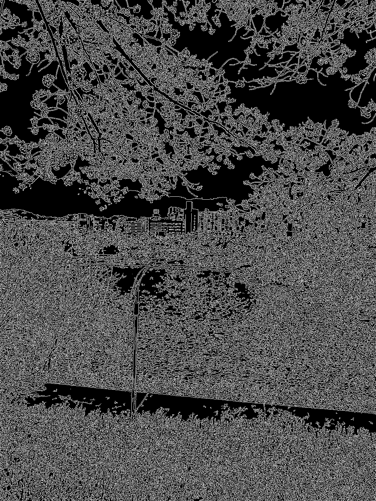
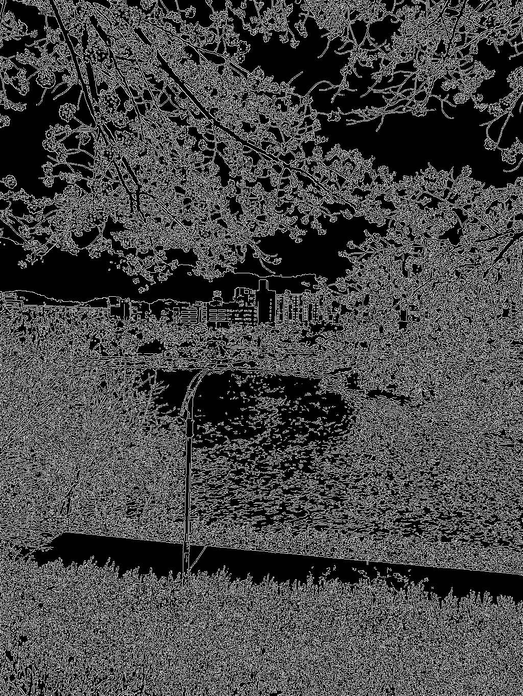
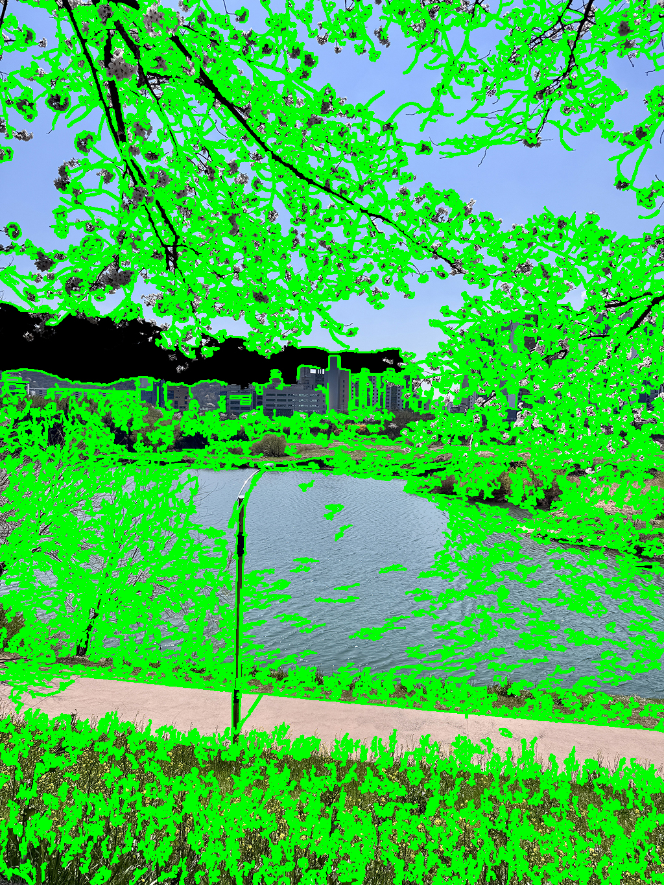

# Edge and Contour Detection

**포트폴리오 제목: Sobel·Canny 기반 경계 검출 및 윤곽선 추출**

동일 이미지에서 Sobel 방향별 경계와 Canny 임계값별 경계를 비교하고, Canny 결과에서 윤곽선을 추출하는 영상처리 실습입니다. 기본 입력은 이 저장소에 포함된 `assets/river.jpg`입니다.

## 처리 과정

1. 입력 이미지를 그레이스케일로 변환합니다.
2. 3×3 Sobel로 x/y 방향 미분을 계산합니다.
3. 절댓값 영상을 `0.5 × |Gx| + 0.5 × |Gy|`로 결합합니다. 이는 시각화용 가중 합이며 유클리드 기울기 크기와 다릅니다.
4. Canny `(50, 150)`과 `(100, 200)`을 각각 실행합니다.
5. `(100, 200)` 결과에서 `RETR_LIST`, `CHAIN_APPROX_NONE`으로 윤곽선을 추출합니다.
6. 점 개수가 **100개를 초과하는** 윤곽선을 원본 위에 표시합니다.

## 실행

Python 3.10 이상을 권장합니다. 아래 명령은 **저장소 루트**에서 실행합니다.

```bash
python -m pip install -r requirements.txt
python edge_and_contour_detection.py
```

자신의 이미지나 윤곽선 기준을 사용할 수도 있습니다.

```bash
python edge_and_contour_detection.py --image assets/mot_color70.jpg --min-contour-points 150 --output-dir results/edges
python edge_and_contour_detection.py --show
```

기본 출력은 `outputs/`입니다. 기본 입력·출력 경로는 스크립트 위치를 기준으로 계산합니다. 사용자 지정 상대 경로는 명령 실행 위치를 기준으로 해석합니다. 기본 실행은 창을 띄우지 않으며, `--show`는 GUI 환경과 GUI를 지원하는 OpenCV가 있을 때 사용합니다.

## 생성 자료

| 파일 | 내용 |
|---|---|
| `original.png`, `grayscale.png` | 컬러 입력과 그레이스케일 입력 |
| `sobel_x.png`, `sobel_y.png` | 방향별 Sobel 경계 |
| `sobel_weighted_strength.png` | 방향별 절댓값 경계의 가중 합 |
| `canny_50_150.png`, `canny_100_200.png` | 임계값에 따른 Canny 결과 |
| `contours_overlay.png` | 선택한 윤곽선을 컬러 입력에 표시 |
| `metrics.json` | 경계 픽셀 수·비율, 전체·선택 윤곽선 수, 선택 윤곽선 점 수·길이, 처리 시간 |

윤곽선 선택 기준은 `len(contour) > --min-contour-points`입니다. JSON의 픽셀 길이는 별도 참고값으로 `cv.arcLength(contour, True)`를 계산합니다. 윤곽선 점 개수와 기하학적 길이는 같은 값이 아닙니다.

## 실제 실행 예시

기본 `river.jpg`에서 윤곽선 27,775개를 추출했으며, 점 개수 기준을 통과한 887개를 표시했습니다. 자세한 결과는 [`results/metrics.json`](results/metrics.json)에 있습니다.

| Canny (50, 150) | Canny (100, 200) |
|---|---|
|  |  |



## 원본과 보완 내용

원본 저장소: [pod369/Image-processing-4](https://github.com/pod369/Image-processing-4)

| 원본 | 기능 | 보관 위치 |
|---|---|---|
| `play_4_1.py` | Sobel 방향별 경계와 가중 합 | `reference/play_4_1.py` |
| `play_4_2.py` | Canny 임계값 2종 비교 | `reference/play_4_2.py` |
| `play_4_3.py` | Canny 기반 윤곽선 추출·필터링 | `reference/play_4_3.py` |

세 실습을 통합하고 이미지 입력·출력 폴더·윤곽선 기준을 CLI로 지정하도록 개선했습니다. 입력 누락 검사, 자동 이미지 저장, 처리 시간과 경계·윤곽선 측정값 JSON 기록을 추가했습니다. 원본의 두 Canny 설정과 점 개수 기준을 유지했습니다. `reference/`에는 원본을 보존했습니다.

## 한계 및 추가 실험

밝기·노이즈·텍스처에 따라 경계가 끊기거나 불필요한 경계가 많아질 수 있습니다. 윤곽선은 객체 의미를 판별하지 않으며 서로 같은 객체에 속하는지 알 수 없습니다. 경계 픽셀 수가 많다고 검출 정확도가 높은 것은 아닙니다. 입력 이미지와 임계값을 바꾸어 시각적 차이, 경계 픽셀 비율, 윤곽선 수를 비교할 수 있습니다.

## AI-Ex 포트폴리오

2026년 2학기 AI-Ex 포트폴리오의 개별 프로젝트입니다. 원본 파일은 `reference/`에 보존했으며, 정리한 실행 코드와 원본을 구분했습니다. 원본 기준 커밋은 `b2f9a5b94bbe353cce22ce469e358bb2715759ce`입니다. 원본 재배포 라이선스는 별도로 추가하지 않았습니다.

실행 예시와 결과 설명은 이 저장소의 루트 구조에 맞췄습니다. `results/`에 포함된 측정 기록은 2026-10-14 실행 당시의 자료로, 과거 통합 폴더 경로가 메타데이터에 남아 있을 수 있습니다.

| 관련 프로젝트 |
|---|
| [SIFT Matching and Homography](https://github.com/pod369/SIFT-Matching-and-Homography) |
| [Superpixel and Normalized Cut](https://github.com/pod369/Superpixel-and-Normalized-Cut) |
| [Image and Video Effects](https://github.com/pod369/Image-and-Video-Effects) |
| [MNIST Handwritten Digit Recognition](https://github.com/pod369/MNIST-Handwritten-Digit-Recognition) |
| [YOLO Hangul Text Detection](https://github.com/pod369/YOLO-Hangul-Text-Detection) |

개별 저장소 검증일: **2026-10-19**. `/tmp` 작업 폴더에서 기본 입력으로 실행해 결과 저장을 확인했습니다. 원본 코드와 입력 이미지의 SHA-256도 보존 여부를 확인했습니다. 기존 `results/`는 2026-10-14 실행 기록을 유지합니다.
